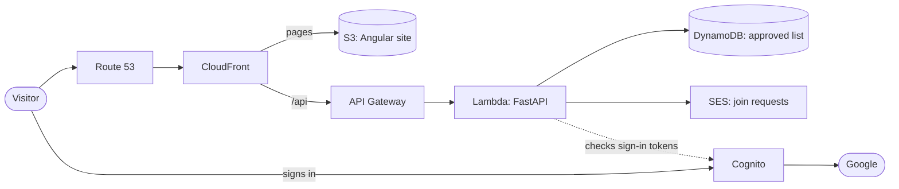
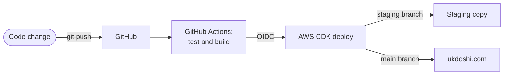

# ukdoshi.com

The source for **[ukdoshi.com](https://ukdoshi.com)**, my personal website: an Angular site and a Python
API running serverless on AWS, with Google sign-in, a private members' area, and a pipeline that tests
every change on a password-protected staging copy before it goes live.

I designed and built it with [Claude Code](https://claude.com/claude-code). For a visual tour of the
architecture, the decisions behind it and a glossary of terms, see
**[How this site is built](https://ukdoshi.com/how-its-built)**.

## At a glance

| | |
|---|---|
| **Frontend** | Angular (TypeScript), served from S3 through CloudFront |
| **Backend** | Python (FastAPI) on AWS Lambda, behind API Gateway |
| **Sign-in** | Amazon Cognito with Google; an approved list in DynamoDB decides who sees the Inner Circle |
| **Email** | Amazon SES, for "Ask to join" requests |
| **Infrastructure** | All of it defined in Python with the AWS CDK |
| **CI/CD** | GitHub Actions: tests, builds and deploys every push, logging in to AWS with OIDC (no stored keys) |
| **Environments** | `staging` branch → staging copy (password-protected) · `main` branch → ukdoshi.com |

## How it fits together





## What's in the repo

| Folder | What's inside |
|---|---|
| [`frontend/`](frontend) | The Angular site: pages in `src/app/pages`, sign-in in `src/app/auth` |
| [`backend/`](backend) | The FastAPI app (`app/`): sign-in checks, the approved list, join requests; tests in `tests/` |
| [`infra/`](infra) | The AWS CDK app: DNS, plus a sign-in stack and a site stack for each of live and staging |
| [`scripts/`](scripts) | Owner tools: approve Inner Circle members, set the staging password |
| [`.github/workflows/`](.github/workflows) | The deploy pipeline |

No secrets live in this repo. The IDs you'll come across (the AWS account, Cognito and the Google sign-in
client) are public by design; the Google client secret and the staging password are stored in AWS.

## Running it locally

You need Python 3.13 and Node.js 24. In two terminals:

```bash
# Backend: http://localhost:8000/api/hello
cd backend
python3 -m venv .venv && .venv/bin/pip install -r requirements-dev.txt
.venv/bin/python -m pytest                    # run the tests
.venv/bin/uvicorn app.main:app --reload       # start the API
```

```bash
# Frontend: http://localhost:4200 (calls to /api go to the backend above)
cd frontend
npm install
npm test -- --watch=false                     # run the tests
npm start                                     # start the site
```

The public pages work with just this. Signing in uses the real Cognito setup, so the members' area needs
AWS access and won't fully work for anyone else running it locally.

## How changes go live

Every push runs [`deploy.yml`](.github/workflows/deploy.yml): backend tests, frontend tests, a production
build, then a CDK deploy. A failing test stops the deploy.

| Branch | Deploys to | Stacks |
|---|---|---|
| `staging` | the staging copy | `UkdoshiStagingAuth`, `UkdoshiStagingSite` |
| `main` | [ukdoshi.com](https://ukdoshi.com) | `UkdoshiDns`, `UkdoshiAuth`, `UkdoshiSite` |

The usual flow: make changes on `staging`, check them on the staging copy, then merge into `main`.

```bash
git switch staging && git merge main              # start from what's live
# ...make changes and commit...
git push                                          # updates the staging copy
git switch main && git merge staging && git push  # updates ukdoshi.com
```

The **Actions** tab shows each run, and **Run workflow** there redeploys a branch by hand.

## For the owner: AWS setup and admin

These need AWS access to the site's account. I use an SSO profile called `ukdoshi`; the scripts default
to it, or set `AWS_PROFILE` to your own.

**One-time setup**

```bash
# Log in to AWS
aws configure sso                 # name the profile: ukdoshi
aws sso login --profile ukdoshi
export AWS_PROFILE=ukdoshi

# Install the CDK app's dependencies
cd infra
python3 -m venv .venv
.venv/bin/pip install -r requirements.txt

# Prepare the account for the CDK
cdk bootstrap

# Create the role GitHub Actions deploys with (by hand, once)
cdk deploy UkdoshiGithubDeploy
```

**Inner Circle members.** Sign-in is with Google only. The API checks each signed-in email against an
approved list:

```bash
# Their Google email and full name; the "Ask to join" email has this command ready to paste
scripts/approve.sh add jane.citizen@gmail.com "Jane Citizen"
scripts/approve.sh remove jane.citizen@gmail.com
scripts/approve.sh list

# Staging has its own list
scripts/approve.sh --staging add tester@gmail.com "Test User"
```

Sign-in is currently hidden from visitors while the Inner Circle is being built; set `SIGN_IN_OPEN` in
[`restricted.ts`](frontend/src/app/pages/restricted/restricted.ts) to bring it back.

**Staging password.** `scripts/staging-password.sh` sets the username and password the staging copy
asks for. It's stored in AWS, never in this repo.

---

© 2026 Utkarsh Doshi. This code is shared to read; all rights reserved.
